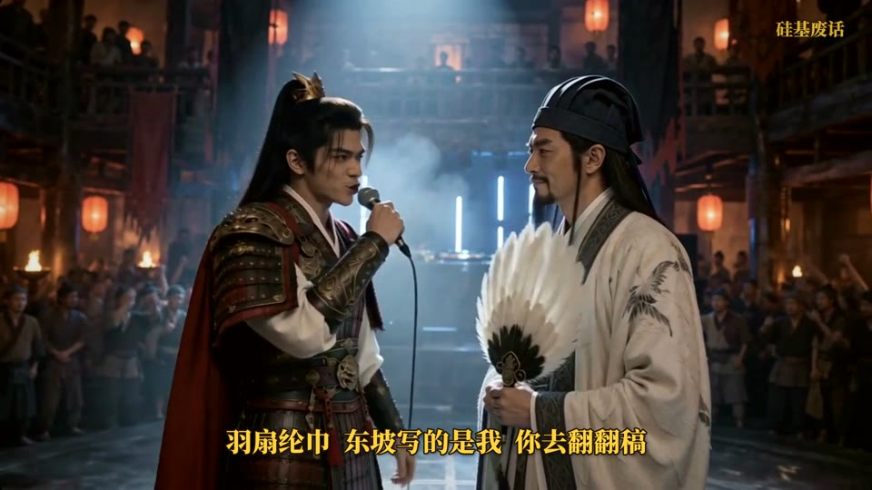

# 古人说唱 Battle · ancient-rap-battle

**一句话做一期：「做一期 曹操 vs 刘备」。** 一个 [Claude Code](https://claude.com/claude-code) Skill，把两个历史上的死对头做成一条 AI 说唱对决短视频：选题写词（每句配史料出处）、做歌、定妆、用即梦 Seedance 2.5 分段生成、自动对口型、剪辑、字幕包装、封面文案，一条龙。

完全免费、开源（MIT）。

## 成片示例：周瑜 vs 诸葛亮（第一期，H3 路线）

周瑜拿正史打，诸葛亮拿演义还手。1 分 42 秒，34 句原创歌词，视频生成花了约 16 美元。

https://github.com/user-attachments/assets/9c620e92-4e5d-4da9-93ff-3ef39cfedbe6

| | |
| --- | --- |
|  |  |

## 它帮你做什么

| 步骤 | 谁来做 |
| --- | --- |
| 1. 选题、写两段 battle 歌词（各 16 句、四句一韵、一句一个典故、每句配史料注释，自动和往期查重） | Claude 写，你确认 |
| 2. 做歌（A 先生成，再用 Extend 接 B，两人声音分得开） | 你在 Suno 生成（Claude 给好每一栏） |
| 3. 分离人声、识别每句时间、剪短前奏、无缝拼接间奏 | 全自动 |
| 4. 定妆图 9 张（两人三视图 / 表情 / 半身、DJ、观众、场景） | 你在 Midjourney 生成（Claude 给好提示词） |
| 5. 生成 11 个素材包：每段的人声、参考图、**写好「几秒到几秒唱哪半句」的提示词** | 全自动 |
| 6. 在即梦网页版上传、生成、下载，满意了放大到 2K | 你 |
| 7. 逐镜头对齐口型（Seedance 唱快唱慢都能挪回音乐上），每段出配音乐小样 | 全自动 |
| 8. 拼接、调色（去 AI 胶质感）、金色字幕、史料注释条、名字卡、开场标题、片尾提问、水印 | 全自动 |
| 9. 封面（竖版 + 横版）和 IG / YouTube / 抖音文案 | 全自动 |

口型能一次对好，靠的是这几条默认规则：每段提示词按半句写清开口和结束的秒数（精确到 0.01 秒）、一句一个镜头、给模型干净且切准的人声、生成后再按镜头自动校准。完整清单见 [references/pitfalls.md](references/pitfalls.md)，即梦网页版的操作见 [references/seedance.md](references/seedance.md)。

也保留了 MiniMax H3 API 路线（批量自动提交、按秒计费），见 SKILL.md。

## 需要什么

- [Claude Code](https://claude.com/claude-code)
- Suno 账号、Midjourney 账号、即梦会员（Seedance 2.5 网页版）
- 可选：MiniMax API Key（H3 路线）
- Python 3.9+ 和 ffmpeg（要带 rubberband，Windows 用 `winget install Gyan.FFmpeg`）
- 本地 Python 包：`pip install demucs faster-whisper pypinyin soundfile scipy numpy pillow`（第一次会下载约 2GB 的模型）

## 安装

```bash
git clone https://github.com/10291124jcjc-dotcom/ancient-rap-battle.git ~/.claude/skills/ancient-rap-battle
```

Windows 上把 `~/.claude/skills` 换成 `%USERPROFILE%\.claude\skills`。然后在 Claude Code 里说：

> 做一期 岳飞 vs 秦桧

Claude 会先跑环境检查，再一步步带你做完。

## 目录

```
SKILL.md                    Claude 的操作手册
scripts/                    analyze_song / retrim / clean_vocal / seedance_packs / seedance_align /
                            seedance_assemble / package / cover（H3 路线：make_clips / h3run / qa / lipcheck / assemble）
references/                 写词规则、Suno、Midjourney、即梦 Seedance、分镜模板、踩坑清单
examples/                   诸葛亮 vs 司马懿（Seedance 路线）、周瑜 vs 诸葛亮（H3 路线）的完整设定
```

## 注意

- 片头已经标了「AI 生成 仅供娱乐」，发布时还要在平台勾选 AI 生成内容声明
- 史料注释是 AI 写的，发布前对着原文核一遍
- Suno 免费版生成的歌**不能商用**，要开收益请用付费版生成最终那首
- 只做古人：不用近现代政治人物和在世真人，脸也不要做得像任何演员

## 作者

硅基废话（X：[@DDJCXX](https://x.com/DDJCXX)）。做出来的视频欢迎 @ 我。
